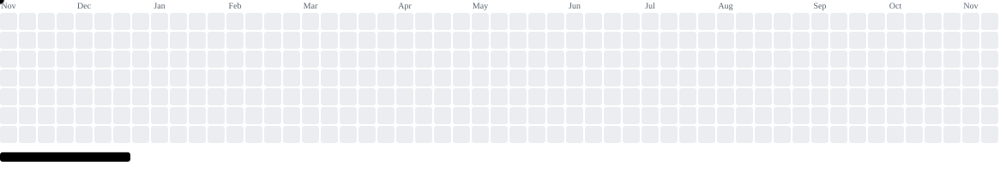

 

<!--LANGS:START-->

<!--LANGS:END-->

<b>CLICK A MONTH TO SEE WHAT I BUILT</b>

  

  

<!--REPOS:START-->

<!--REPOS:END-->

  

<picture>
    <source media="(prefers-color-scheme: dark)" srcset="https://raw.githubusercontent.com/arpz-dev/arpz-dev/pacman-output/breakout-contribution-graph-dark.svg">
    <source media="(prefers-color-scheme: light)" srcset="https://raw.githubusercontent.com/arpz-dev/arpz-dev/pacman-output/breakout-contribution-graph.svg">
    
</picture>

  

