  

  

  

  

  

  

  

<table align="center">
  <tr>
    <td align="center">
      
    </td>
    <td align="center">
      
    </td>
  </tr>
  <tr>
    <td align="center">
      
    </td>
    <td align="center">
      
    </td>
  </tr>
</table>

  

  

  

  

<picture>
    <source media="(prefers-color-scheme: dark)" srcset="https://raw.githubusercontent.com/arpz-dev/arpz-dev/pacman-output/breakout-contribution-graph-dark.svg">
    <source media="(prefers-color-scheme: light)" srcset="https://raw.githubusercontent.com/arpz-dev/arpz-dev/pacman-output/breakout-contribution-graph.svg">
    
</picture>

  

